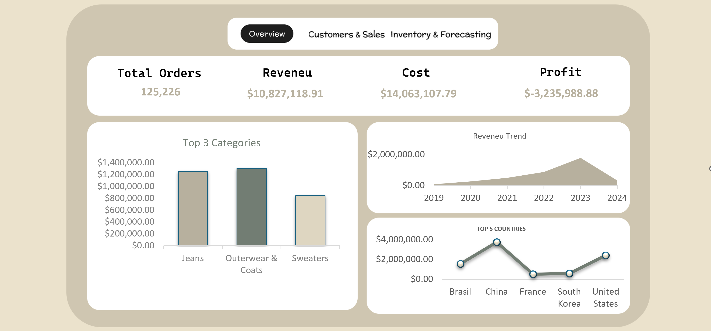
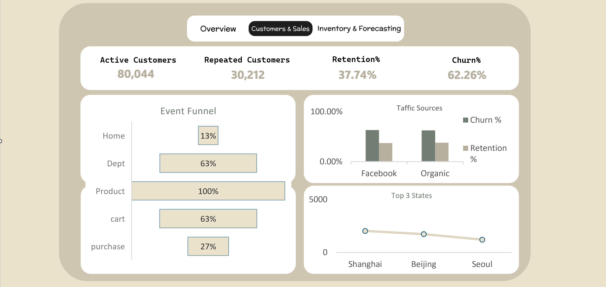
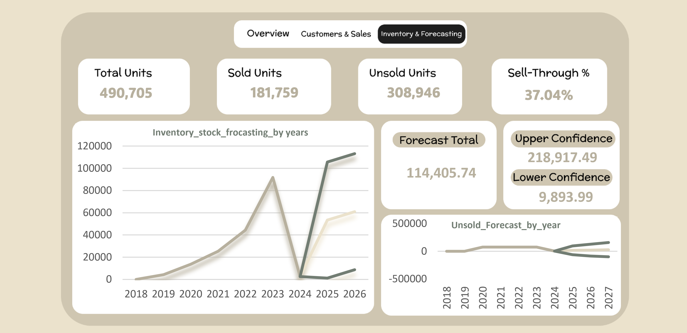

# theLooker-ecommerce-analysis-excel
## Download
[Download Excel workbook](https://drive.google.com/file/d/1JvUGYGJM-_7ePNTiGtl4368Vq2IUIBwb/view?usp=sharing)
## Overview
End-to-end analysis of an e-commerce dataset using Excel.
## Dataset
TheLook E-commerce (orders, order_items, products, users, events, inventory_items, distribution_centers).

## Project Phases
1. Data cleaning and preparation (Power Query)
2. Web behavior and funnel analysis (Power Query)
3. Modeling and DAX measures (Power Pivot)
4. Pivot Table validation and dashboard
5. Demand forecasting and inventory planning (Forecast Sheet ETS)

## Recommendations
- Reduce replenishment orders across all distribution centers
- Clear surplus stock through promotions
- Re-run the forecast monthly or quarterly

## How to Reproduce
1. Download the workbook from the link above
2. Open it in desktop Excel (not the browser)
3. Data → Refresh All

## Tools
Excel, Power Query, Power Pivot, DAX, Forecast Sheet (ETS)

## Key Findings
- Session → Cart: 63.39%
- Cart → Purchase: 26.66% (cart abandonment ≈ 73%)
- All distribution centers are overstocked, no stock-out risk in the forecast period

## Dsahboard Overview
### Overview

### Customer

### forecasting

